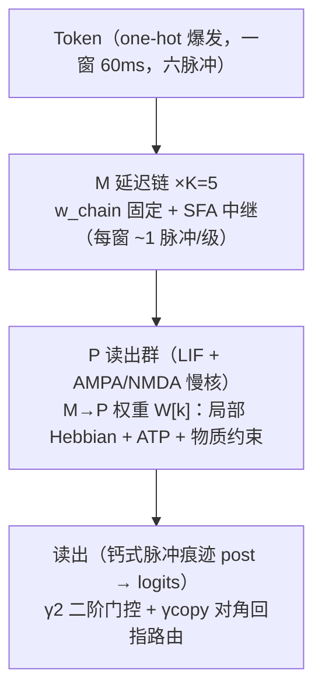

# StageSNN：纯前向、本地可塑性的脉冲语言模型

> **实验分支 `mem`** —— 双时间尺度巩固（fast W + slow W_s）。本分支当前版本 `0.1.1`（`StageSNN_mem_0.1.1.py`）；主线见 `main`（`bio` 系列，最新 `1.2.0`）。实验分支共享同一 Zenodo 概念 DOI 归档。

[](https://doi.org/10.5281/zenodo.23468679)
[](https://www.gnu.org/licenses/agpl-3.0)
[](https://orcid.org/0009-0006-4332-1295)
[](https://www.python.org/downloads/)
[](https://numpy.org/)
[](https://numba.pydata.org/)

**A forward-only, single-file spiking language model trained purely with local plasticity rules — no backpropagation, no PyTorch, CPU-only.**
**单文件、纯前向、只用局部可塑性规则训练的脉冲语言模型 —— 无反向传播、无 PyTorch、CPU 即可完整训练。**

> **当前最新 / Latest：`1.2.0`（2026-10-19）** —— **先验门控自适应化（滑动阈值）**：γ2 / γcopy 的固定绝对阈值（`GATE2_KAPPA=0.5` / `COPY_KAPPA=0.3`）替换为 **BCM 式滑动修改阈值** —— 更新参考量改为各统计量自身的 EMA 基线（时间尺度复用各门自身 τ，**零新增参数、零手调常数**）。更新天然零均值，长训不再单向漂移。动机（研究线实证）：real1 续训后门控读出反向伤害（关 γcopy 读出：acc 12.30%→**14.19%**）；小语料 30k 轨迹旧规则 acc 15.2%→9.86%（γc_max 0.16→0.25 爬升）。新规则重验 P3 判据：**ca_lag4 191/191=1.000**、acc 37.62%（旧 37.64%）、cal PPL 111.92（旧 108.40，仍远优 bigram 306.6 / trigram 128.6）。双后端烟测指标逐位一致。

> **上一版 / Previous：`1.1.2`（2026-10-19）** —— 惰性逐行衰减（默认开；17.2→9.5 ms/token）+ 两处内核缩进缺陷修复（eager 与 1.1.1 逐位一致）。

**语言 / Language:** [中文文档](#中文文档) · [English Documentation](#english-documentation)

---

<a name="中文文档"></a>

# 中文文档

## 项目简介

StageSNN 是一个**单文件**的脉冲神经网络语言模型（SNN-LM）：整个模型、训练、评估、数据管线都在一个 `.py` 文件里（外壳沿用同作者的 312*elite 系列菜单/日志/数据约定，内核为 StageSNN 阶段链脉冲内核）。它**不使用反向传播**、**不依赖 PyTorch/GPU**，而是用一组生物学上可解释的**局部可塑性规则**（Hebbian + ATP 疲劳 + 二阶调制）逐 token 在线学习，CPU 即可完整训练。

项目最初的目标是一个**可验证的结构性命题**：一个纯前向的脉冲系统，能否仅靠局部可塑性，在下一 token 预测上**击败同训练协议下的高阶词间统计基线**（n-gram）。答案是肯定的（见「结果」），此后进入真实中文问答语料的规模化验证。

## 设计红线（不可逾越）

- **无反向传播**：不存在任何形式的全局梯度链（无 BP/Adam/…）；所有学习都是逐突触的局部规则。
- **无两次前向对比**：不存在"跑两遍做差"式的目标信号（如对比学习 / target 网络）。
- **无 t+1 目标注入**：评分语义为 `logits[i]` 预测 `ids[i]`（上下文 `w_{i-1..i-K}` 驱动），不是把下一个 token 直接喂给读出层。
- **无外部预训练词表/先验**：字符级词表仅从**训练切分**构建（防验证集泄露）。
- **网络内部无交叉熵/导数**：softmax / PPL / 温度只存在于评估端。
- 不依赖 GPU：CPU 即可完整训练。

## 架构总览



**内核要点（单文件、可审计）：**

- **时间结构**：一窗 = 一个 token = 60 ms；输入为窗内六个固定时刻的脉冲爆发；每 4 ms 一次可塑性更新；读出发生在窗末前 4 ms。
- **M 延迟链**：K=5 级，每级将上一级的脉冲中继一窗后继续传递（上下文深度的物理实现）；链权重固定，靠 SFA（脉冲频率适应）保证每窗约 1 个脉冲中继。
- **P 读出群**：LIF 神经元群，受 AMPA（快）与 NMDA（慢）双时间尺度驱动；M(第 i−k 级)→P 的权重 `W[k]` 是唯一被学习的突触：
  - `ΔW = η · dt · pre · avail · outer(coef, post)`，其中 `post` 为钙式脉冲痕迹；
  - `avail = relu(1 − rowsum/B)`：物质（权重预算）约束，天然防权重爆炸；
  - ATP 疲劳：每次脉冲消耗资源、缓慢恢复，实现自组织。
- **先验门控（默认开启）**：
  - **γ2（二阶突触）**：`explaining-away` 式抑制，防止共现特征被重复计入；
  - **γcopy（对角回指路由）**：让读出可以"回指"本窗输入结构，显著改善结构性指标。
  两者的更新均使用 **BCM 式滑动阈值**（`1.2.0` 起）：参考量为 `post` / 获胜列 `Mc_read` 的 EMA 基线（时间尺度复用各门自身 τ），更新零均值、无手调常数、长训不漂移。
- **评估协议**：掩码口径（仅 assistant 段计分，含结束符；其余为 0）；温度仅在**训练集切片**上自校准；ACC（温度无关）为第一指标。

## 快速开始

**环境**：Python ≥ 3.9；`numpy`（必需）；`numba`（可选，缺失或编译失败时自动回退 NumPy）。

```bash
# 交互菜单（数据管线 / 训练 / 评估 / 对话 / 统计 / 保存）
python StageSNN_mem_0.1.1.py

# 数据管线：v5 messages 格式 jsonl → 字符级 ids/mask（词表仅训练切分；100 条验证对话，seed 0 打乱）
python StageSNN_mem_0.1.1.py data --src dsr1_v5_0001.jsonl --out stage_data

# 分块训练（CPU；菜单续训自动推算下一分块偏移）
python StageSNN_mem_0.1.1.py train --data-dir stage_data --tag bio1 --tokens 100000 --backend auto

# 评估 / n-gram 基线对照 / 对话生成 / 统计
python StageSNN_mem_0.1.1.py eval      --data-dir stage_data --brain stage_runs/bio1/snapshot.npz
python StageSNN_mem_0.1.1.py baselines --data-dir stage_data
python StageSNN_mem_0.1.1.py chat      --prompt "你好" --brain stage_runs/bio1/snapshot.npz
python StageSNN_mem_0.1.1.py stats     --data-dir stage_data
```

**数据目录约定**（由 `data` 子命令生成）：`train_ids.npy`、`train_mask.npy`、`val_ids.npy`、`val_mask.npy`、`vocab.json`、`meta.json`；运行与快照写入 `stage_runs/<tag>/`。

**关键参数**集中在文件头「统一开关区」：

| 开关 | 默认 | 说明 |
|---|---|---|
| `VOCAB_SIZE` | `3000` | 字符级词表上限（仅训练切分构建，防验证集泄露） |
| `BACKEND` | `"auto"` | `auto` / `numpy` / `numba`；numba 缺失自动回退 |
| `DECAY_AMORT_STEPS` | `100` | 被动衰减摊销步数（数学等价：因子按 `e^{-N·dt/τ}` 精确放大） |
| `LAZY_DECAY` | `True` | 惰性逐行衰减（默认开；与逐事件衰减严格同语义；置 `False` 回退全阵衰减的极限对齐路径） |

## 性能与验证

**速度**（V=3000，训练含读出；CPU、实测保守口径，ms/token）：

| 路径 | 配置 | 耗时 |
|---|---|---|
| `1.0.0` NumPy（逐事件全阵衰减） | — | ~37 |
| `1.1.0` NumPy | amort=100 | ~18.6 |
| `1.1.0` Numba | amort=100 | ~10.7（3.5×） |
| `1.1.1` Numba（v2 稀疏内核） | amort=100 | 同刻对照 numpy 加速 1.3~1.8×（指标逐位一致） |
| `1.1.2` Numba（惰性衰减，默认开） | amort=25 | **9.5**（同期 NumPy 22.6；amort 开销≈0） |

**数值等价性**（NumPy 基准 ↔ Numba，big3 快照 + 门控，300 token 学习）：

| 路径 | Δlogits | argmax | ΔW | Δγ2 | Δγc | ltp relΔ |
|---|---|---|---|---|---|---|
| lazy（默认；`1.2.0` 复测，滑动阈值规则） | 1.5e-5 | 100% | 8.9e-7 | 2.0e-6 | 4.8e-7 | 2.0e-7 |
| eager（回退路径；`1.1.2` 参考，衰减时序本版未改） | 7.6e-6 | 100% | 3.0e-8 | 1.2e-7 | 6.0e-8 | 1.9e-9 |

另有：新模型 n≤40 token 扫描两种路径均 ~1-ULP 级（ΔW 2~7e-9）；脉冲计数逐 token 一致；双后端烟测（300/400 token）指标逐位一致。

**结果**（研究线记录）：

- **结构性命题（已达成）**：研究语料（V=2706，训练约 29.6k tokens）上，模型 **PPL 108.40 / ACC 37.64%**（γ2+γcopy 开启）；同协议基线 — unigram 434.9 / 13.4%，bigram 306.6 / 30.2%，4-gram 466.0 / 30.2%。即：**纯前向 + 局部可塑性可以击败高阶词间统计基线**。
- **真实中文问答语料（进行中）**：字符级 V=3000，训练切分 2.79M 字符（92.4% 掩码）；分块训练进行中 — chunk1 后掩码口径 val_ppl 2297.9 / ACC 15.93%，chunk2 后出现回退（2593.8 / 12.30%）；诊断定位为固定阈值门控在长训后的读出污染，已在 `1.2.0` 以滑动阈值修复（详见 CHANGELOG 1.2.0；同协议基线 unigram 418.2 / bigram 138.9，模型仍在爬坡）。

## 版本历史

| 版本 | 日期 | 要点 | 文件 | Release |
|---|---|---|---|---|
| `1.0.0` | 2026-10-19 | 首版交付：elite 外壳 + StageSNN 阶段链脉冲内核（K=5 延迟链 M + P 读出群 + 局部 Hebbian/ATP + γ2/γcopy）；移除依赖反向传播的旧内核与 RL/GRPO | `v1.0.0/` | [Release](https://github.com/X005-0001-0001/StageSNN/releases/tag/1.0.0) |
| `1.0.1` | 2026-10-19 | 工程化清理：数值阈值/精度下限全部具名开关化（去魔数）；菜单续训自动推算下一分块偏移；预览长度开关（不改内核数学与数值行为） | `v1.0.1/` | [Release](https://github.com/X005-0001-0001/StageSNN/releases/tag/1.0.1) |
| `1.1.0` | 2026-10-19 | 内核加速：可选 numba 热路径（等价验证 logits Δ~1e-6 / ΔW~1e-8）+ DECAY_AMORT_STEPS 被动衰减摊销（37→10.7 ms/token，3.5×） | `v1.1.0/` | [Release](https://github.com/X005-0001-0001/StageSNN/releases/tag/1.1.0) |
| `1.1.1` | 2026-10-19 | numba 热路径 v2：稀疏脉冲列表化（严格等价：Δ≤1e-5、烟测指标逐位一致；对照 numpy 1.3~1.8×） | `v1.1.1/` | [Release](https://github.com/X005-0001-0001/StageSNN/releases/tag/1.1.1) |
| `1.1.2` | 2026-10-19 | 惰性逐行衰减（默认开；严格同语义，Δlogits 3.4e-5 / ΔW 8.9e-7；17.2→9.5 ms/token）+ 两处内核缩进嵌套缺陷修复（eager 与 1.1.1 逐位一致） | `v1.1.2/` | [Release](https://github.com/X005-0001-0001/StageSNN/releases/tag/1.1.2) |
| `1.2.0` | 2026-10-19 | 先验门控自适应化：BCM 式滑动修改阈值（删除固定 kappa 常数，零新增参数）；P3 判据重验通过（ca 191/191、acc 37.62%）；双后端逐位一致 | `v1.2.0/` | [Release](https://github.com/X005-0001-0001/StageSNN/releases/tag/1.2.0) |
| `mem-0.1.1` | 2026-10-20 | 实验分支：numba 双后端恢复（慢库/使用度/rho 移植，等价性 Δlogits 3.8e-6、numba ~2.7×；双后端烟测逐位一致） | `v0.1.1/` | [Release](https://github.com/X005-0001-0001/StageSNN/releases/tag/mem-0.1.1) |
| `mem-0.1.0` | 2026-10-19 | 实验分支：双时间尺度巩固（慢库 W_s 无衰减，rho 按相对使用度分拆；cal PPL 106.70 / acc 37.75% / ca 191/191；30k 末端 ppl 2204.8/acc 14.57% 抑制近因塌陷；numba 未移植→强制 numpy） | `v0.1.0/` | [Release](https://github.com/X005-0001-0001/StageSNN/releases/tag/mem-0.1.0) |

每个版本对应一个 GitHub Release，并由 [Zenodo](https://zenodo.org) 自动归档、分配 DOI。

## 引用

若本项目对你的研究有帮助，请引用。归档 DOI：[10.5281/zenodo.23468679](https://doi.org/10.5281/zenodo.23468679)（概念 DOI，指向最新版；`1.0.0`–`1.1.2` 各版本的版本 DOI 见 Zenodo 页面与 Releases）；机器可读元数据见 `CITATION.cff`：

```bibtex
@software{stagesnn2026,
  author  = {Zeng, Naiqi},
  title   = {StageSNN: A Forward-Only, Biologically-Plausible Spiking Language Model},
  year    = {2026},
  url     = {https://github.com/X005-0001-0001/StageSNN},
  doi     = {10.5281/zenodo.23468679},
  license = {AGPL-3.0}
}
```

## 许可

本项目采用 **GNU Affero General Public License v3.0（AGPL-3.0）**，详见 [LICENSE](LICENSE)。

---

<a name="english-documentation"></a>

# English Documentation

## Overview

**StageSNN** is a single-file spiking neural language model trained **purely with local plasticity** — no backpropagation, no PyTorch, no GPU required. Model, training loop, evaluation and the data pipeline all live in one auditable `.py` file:

- **Input**: one-hot token bursts (six spikes per 60 ms window; one window = one token).
- **M chain**: a K=5 delay chain physically implementing context depth (fixed chain weights + SFA relay, ~1 spike per stage per window).
- **P readout population**: LIF neurons driven by AMPA/NMDA kernels; the only learned synapses `W[k]` (stage i−k → P) follow a local Hebbian rule with ATP fatigue and a material constraint `avail = relu(1 − rowsum/B)`.
- **Priors**: γ2 second-order synapses (explaining-away) and γcopy diagonal copy routing, both on by default.
- **Scoring**: `logits[i]` predicts `ids[i]` (no t+1 target injection); temperature is calibrated on a *training* slice only; accuracy (temperature-free) is the primary metric.

- **Adaptive gates (1.2.0)**: γ2/γcopy use **BCM-style sliding thresholds** (per-unit EMA baselines at each gate's own timescale) instead of fixed kappa constants — zero-mean updates, no hand-tuned thresholds, no long-run drift.

## Red Lines (Non-Negotiable)

1. No backpropagation of any kind — local plasticity rules only.
2. No two-forward comparison signals (no contrastive/target-network objectives).
3. No target injection: evaluation is next-symbol prediction from windowed context.
4. No external pretrained vocabularies/priors — vocab is built from the *training* split only.
5. No cross-entropy/derivatives inside the network (softmax/PPL exist only in evaluation).
6. No GPU dependency (CPU-only).

## Quick Start

```bash
python StageSNN_mem_0.1.1.py                    # interactive menu
python StageSNN_mem_0.1.1.py data --src corpus.jsonl --out stage_data
python StageSNN_mem_0.1.1.py train --data-dir stage_data --tag bio1 --tokens 100000 --backend auto
python StageSNN_mem_0.1.1.py eval | baselines | chat | stats  # evaluation & tooling
```

Requirements: Python ≥ 3.9, NumPy. Data format: `train_ids.npy`, `train_mask.npy`, `val_ids.npy`, `val_mask.npy`, `vocab.json`, `meta.json` produced by the `data` subcommand from a v5-messages JSONL corpus.

## Verified Results

| Protocol | Model | Baselines |
|---|---|---|
| Research corpus, V=2706 (~29.6k train tokens) | **PPL 108.40 / ACC 37.64%** | unigram 434.9 / 13.4% · bigram 306.6 / 30.2% · 4-gram 466.0 / 30.2% |
| Real Chinese QA corpus, V=3000 (2.79M train chars, masked) | in progress (val_ppl 2297.9 / ACC 15.93%) | unigram 418.2 · bigram 138.9 |

## Versions & Archival

See the [releases page](https://github.com/X005-0001-0001/StageSNN/releases); every release is archived by Zenodo with its own version DOI. Concept DOI: [10.5281/zenodo.23468679](https://doi.org/10.5281/zenodo.23468679).

## Citation & License

Citation metadata: `CITATION.cff`. License: **AGPL-3.0** — see [LICENSE](LICENSE).
